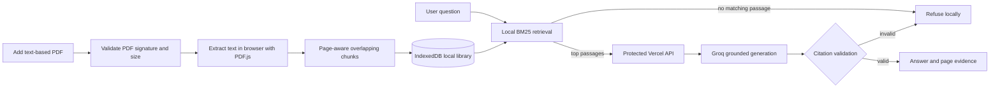

# The Relay RAG

Private, evidence-grounded question answering for your own PDFs.

The Relay RAG indexes text-based PDFs inside the browser, retrieves relevant passages locally, and sends only those passages—not the full documents—to a protected Groq-backed answer route. Every displayed factual answer must cite supplied evidence; otherwise the app refuses.

## Why this project exists

Most document chat demos hide where files go, return fluent answers without support, or require a vector database before the first question. The Relay RAG is intentionally different:

- **Local-first:** PDFs and the searchable index live in IndexedDB in the current browser.
- **Evidence-bound:** every model claim must include source IDs and an exact quote that is checked against the retrieved passage.
- **Fail-closed:** unrelated questions are refused locally; answers with missing or unknown citations are not shown as verified.
- **Deployable:** one Next.js application hosts both the interface and the protected Groq route on Vercel.
- **Transparent:** no hidden upload service, vector database, or analytics SDK is required.

## Product flow



## Current capabilities

- Multi-PDF upload with drag-and-drop
- PDF magic-byte, extension, and 25 MB size validation
- Browser-side PDF text extraction and page provenance
- Overlapping, page-aware chunks
- Local BM25 ranking across selected documents
- Groq answer generation with prompt-injection separation
- Claim-level citation, exact-quote validation, and evidence drawers
- Light, dark, and true-black themes
- Responsive desktop and mobile interface
- Local activity feed, document deletion, and source selection
- Access-code protection, rate limiting, provider timeout, and safe error states

## Technology

| Layer | Choice | Reason |
|---|---|---|
| Web app | Next.js 16 + React 19 + TypeScript | One deployable full-stack project with strict types |
| PDF extraction | PDF.js | Mature browser-side text extraction; files stay local |
| Persistence | IndexedDB via `idb` | Per-browser document isolation without a storage account |
| Retrieval | BM25 | Fast, inspectable, deterministic lexical baseline in the browser |
| Generation | Groq Chat Completions | Low-latency hosted inference behind a server route |
| Validation | Zod + deterministic citation checks | Bounded inputs and fail-closed response handling |
| Tests | Vitest | Small, fast unit tests for the safety-critical data path |

## Quick start

Requirements: Node.js 24 or newer and a Groq API key.

```bash
git clone https://github.com/Parth7881/the-relay-rag.git
cd the-relay-rag
npm install
copy .env.example .env.local
npm run dev
```

Set these values in `.env.local`:

```dotenv
GROQ_API_KEY=your_key
GROQ_MODEL=llama-3.3-70b-versatile
```

Open `http://localhost:3000`, add a text-based PDF, select it, and ask a specific question.

## Commands

```bash
npm test       # retrieval, chunking, validation, and prompt-contract tests
npm run lint   # Next.js and TypeScript lint rules
npm run build  # production build and full type check
npm start      # serve the production build
```

## Deploy to Vercel

1. Import this repository into Vercel.
2. Add `GROQ_API_KEY` and `GROQ_MODEL` as Production environment variables.
3. Deploy. Vercel detects Next.js automatically.

Do not prefix secrets with `NEXT_PUBLIC_`. Client-visible environment variables are bundled into the browser.

## Security and privacy model

- PDF bytes, extracted pages, and the complete index stay in IndexedDB.
- Only the question and up to ten retrieved passages are posted to `/api/ask`.
- The API key remains server-side.
- Production answering is disabled unless `GROQ_API_KEY` exists.
- Model input treats retrieved text as untrusted reference material, not instructions.
- The API byte-limits request bodies before JSON parsing, validates request shape, and checks each generated claim against exact source text.
- Requests have a bounded per-client in-memory rate window. This remains a lightweight control, not a globally consistent distributed quota.

See [SECURITY.md](SECURITY.md) for reporting and deployment guidance.

## Honest limitations

- Image-only/scanned PDFs require OCR and are rejected in this version.
- PDFs are limited to 400 pages, 1.5 million extracted characters, 4,000 passages per document, 30 documents, and 20,000 local passages.
- Tables, equations, multi-column reading order, and diagrams may not extract perfectly.
- BM25 is strong for exact terminology but can miss paraphrases. A semantic reranker should only be added after measuring a representative evaluation set.
- IndexedDB is local to one browser profile and can be cleared by the user or browser.
- There is no account sync, team workspace, or cross-device document library.
- Serverless in-memory rate limits are per warm instance. A public high-traffic deployment should add durable rate limiting and real user authentication.
- Citations show the retrieved passage and PDF page number; users should still verify high-stakes claims in the original file.

## Future upgrades worth benchmarking

These are deliberate extensions, not unverified claims about the current system:

1. **Hybrid lexical + dense retrieval** with reciprocal-rank fusion for paraphrased questions.
2. **Cross-encoder reranking** for improved top-passage precision.
3. **Structure-aware parsing** with Docling for complex academic PDFs.
4. **Visual retrieval / ColPali** for figure- and layout-heavy documents.
5. **OCR fallback** for scans, with clear confidence and page-level provenance.
6. **Authenticated cloud workspaces** with per-user encrypted storage and durable quotas.

Each upgrade should earn its complexity through a fixed evaluation set measuring retrieval recall, answer support, latency, and cost.

## Repository policy

Secrets, local environment files, browser data, generated builds, and deployment metadata are ignored. This public repository contains only source code, tests, documentation, and dependency locks.

## License

MIT — see [LICENSE](LICENSE).
